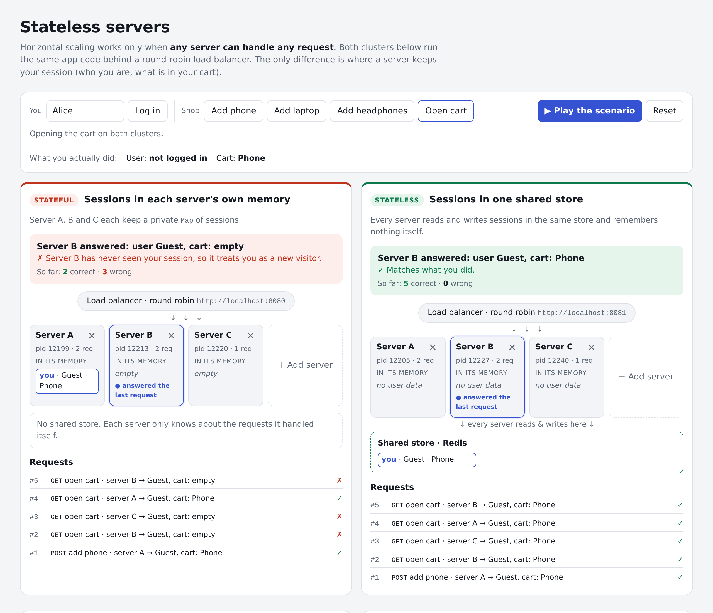

# Stateless servers: an interactive demo

Horizontal scaling works only when **any server can handle any request**. The main thing that breaks this is **state**: data a server remembers between requests, like a login session or a shopping cart.

This repo runs two small clusters side by side, each with three real server processes behind a round-robin load balancer. Both run **the exact same app code**. The only difference is where a server keeps the session:

| | Stateful cluster | Stateless cluster |
|---|---|---|
| Where sessions live | In each server's own memory (a `Map`) | In one shared store (Redis) |
| Add a phone on server A, open the cart on server B | **Empty cart.** B has never seen you. | **Phone is there.** B reads it from Redis. |
| Add a server | The new server knows nobody | Serves every user right away |
| A server dies | Everyone whose session was on it loses it | Nothing is lost |

<picture>
  <source media="(prefers-color-scheme: dark)" srcset="docs/screenshot-dark.png">
  
</picture>

## Run it

You need Node.js 18.17 or newer.

```bash
git clone https://github.com/Aleksandar1567/stateless-servers-demo.git
cd stateless-servers-demo
npm install
npm start
```

Open **http://localhost:3000** and press **▶ Play the scenario**.

Without `REDIS_URL`, the stateless cluster uses a tiny built-in key-value store that runs as its own process, so nothing else needs to be installed. To use real Redis:

```bash
# with Docker: Redis + the demo
docker compose up --build

# or with a Redis you already have running
REDIS_URL=redis://localhost:6379 npm start
```

## Things to try

1. **▶ Play the scenario.** Add a phone, then open the cart three times. On the left, the cart is only visible when the request lands on the server that stored it. On the right, every server returns it.
2. **Log in**, then press **Open cart** a few times. On the left, you are logged in on one server and a guest on the others.
3. **Stop (×) the server that holds your cart** on the left. Your cart is gone for good. Stop any server on the right: nothing is lost.
4. **+ Add server** on the right. It serves your cart immediately, because it reads the same store. On the left, the new server knows nobody.

Each server card shows what that server process has in its memory, and the dashboard marks which server answered the last request.

## Terminal version

```bash
npm run demo:cli
```

It starts both clusters on random ports, replays the scenario and prints what happened:

```
STATEFUL cluster  3 servers, sessions live in each server's own memory

  user adds a phone    POST /api/cart  -> server A   cart: phone   OK
  user opens the cart  GET /api/cart   -> server B   cart: empty   WRONG: server B has no cart for this user
  user opens the cart  GET /api/cart   -> server C   cart: empty   WRONG: server C has no cart for this user
  user opens the cart  GET /api/cart   -> server A   cart: phone   OK

STATELESS cluster  3 servers, sessions live in one shared store: built-in key-value store

  user adds a phone    POST /api/cart  -> server A   cart: phone   OK
  user opens the cart  GET /api/cart   -> server B   cart: phone   OK
  user opens the cart  GET /api/cart   -> server C   cart: phone   OK
  user opens the cart  GET /api/cart   -> server A   cart: phone   OK
```

Or poke the load balancers yourself while `npm start` is running (`-c`/`-b` keep the session cookie, like a browser):

```bash
curl -s -c jar -b jar -X POST localhost:8080/api/cart -H 'content-type: application/json' -d '{"item":"phone"}'
curl -s -c jar -b jar localhost:8080/api/cart   # "servedBy":"B", "cart":[]  <- stateful
```

Run the same two commands against `:8081` and the second one returns the phone.

## How it works

```
                    STATEFUL                                    STATELESS

                  browser                                       browser
                     │                                             │
          load balancer :8080 (round robin)             load balancer :8081 (round robin)
           ┌─────────┼─────────┐                         ┌─────────┼─────────┐
       server A  server B  server C                  server A  server B  server C
       [ Map ]   [ Map ]   [ Map ]                       └─────────┼─────────┘
       each one remembers only                              shared store
       the requests it handled                              (Redis)
```

Every app server is a separate OS process, so it has its own memory, just like separate machines would. The load balancer sends request 1 to server A, request 2 to server B, and so on. It knows nothing about users.

The session cookie only holds an id. What matters is where the data behind that id lives. In [`src/app-server.js`](src/app-server.js) that is a single line:

```js
const sessions = await createStore(process.env.STORE ?? 'memory', process.env.STORE_URL);
```

`STORE=memory` gives a stateful server. `STORE=redis` (or `http`, for the built-in store) gives a stateless one. The rest of the code is identical.

| File | What it is |
|---|---|
| [`src/app-server.js`](src/app-server.js) | The app: `GET /api/cart`, `POST /api/cart`, `POST /api/login` |
| [`src/stores/`](src/stores/) | Where sessions are kept: memory, Redis, or the built-in store |
| [`src/load-balancer.js`](src/load-balancer.js) | Round-robin reverse proxy, about 70 lines |
| [`src/cluster.js`](src/cluster.js) | Starts server processes and registers them with the load balancer |
| [`src/shared-store-server.js`](src/shared-store-server.js) | The built-in stand-in for Redis |
| [`src/dashboard.js`](src/dashboard.js), [`public/index.html`](public/index.html) | The web UI on :3000 |
| [`test/demo.test.js`](test/demo.test.js) | Tests for both behaviours (`npm test`) |

## What about sticky sessions?

A load balancer can pin each user to one server (“sticky sessions”), which hides the problem on the left. It does not remove it: load spreads unevenly, a restarted or crashed server still loses its users' sessions, and removing a server to scale down logs people out. Moving state to a shared store, as on the right, is what makes servers interchangeable. Another option is to keep the state on the client in a signed token (for example a JWT), which also leaves the servers stateless.

## License

MIT
